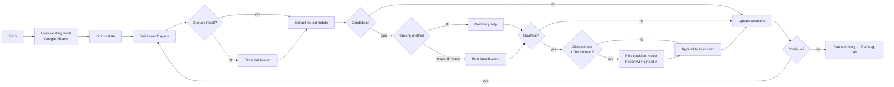

# Hiring Signal Lead Engine

An **n8n** workflow that finds job postings on public job boards and turns them into leads in Google Sheets. You choose how postings are ranked: **Gemini AI**, simple **keyword scoring** that needs no API key, or **no ranking**.

A job post means a company has a need right now. One engine, two modes:

| Mode | Who it's for | A job post means… | Extra step |
|---|---|---|---|
| **Find clients** | Dev agencies, freelancers, recruiters, outsourcing firms | "This company might buy my services" | Finds a decision-maker (CTO, founder, HR) on LinkedIn |
| **Find jobs for me** | Job seekers | "This job might fit me" | Scores the job against your CV and gives a tailoring tip |

## Just want to use it?

**You only need two things from this repo:**

1. [`workflow/hiring-signal-lead-engine.json`](workflow/hiring-signal-lead-engine.json): the workflow. Download it (open the file → **Download raw file**) and import it in n8n via **⋯ → Import from File**.
2. [`sheets/`](sheets): the header rows for your Google Sheet's `Leads` and `Run Log` tabs.

Then follow [Setup](#setup) to connect your credentials. You can ignore everything else in the repo (`src/`, `scripts/`, `tests/`). It's only needed if you want to change the code; see [Development](#development).

| Path | What it is | Needed to run? |
|---|---|---|
| `workflow/*.json` | The n8n workflow | ✅ Yes |
| `sheets/*.csv` | Sheet header rows | ✅ Once, for setup |
| `src/nodes/*.js` | Readable source of each Code node (already inside the JSON) | ❌ Dev only |
| `scripts/build_workflow.py` | Rebuilds the JSON from `src/nodes/` | ❌ Dev only |
| `tests/simulate.js` | Offline test with mocked APIs | ❌ Dev only |

## Features

- **Searches several boards**: LinkedIn Jobs, Rozee.pk, Indeed, Bayt, Greenhouse, Lever, or any website. It does this through Firecrawl's search API. It doesn't log in anywhere or scrape LinkedIn itself.
- **Smart query rotation**: rotates boards and query patterns, broadens step by step when results dry up, and filters by date (past 24h, week or month).
- **One search feeds several leads**: extra results are queued, so a single paid search can produce several leads.
- **Choose the ranking method on the form**:
  - **AI ranking (Gemini)**: an LLM scores the fit and writes a reason plus a pitch angle or application tip.
  - **Keyword ranking (no AI)**: a free, instant score based on whether the role appears in the title, how many of your skills appear in the posting, and whether the location matches. No Gemini key needed.
  - **No ranking (save all)**: saves every valid, non-duplicate posting. This is the fastest and cheapest option.
- **AI qualification details**: Gemini returns structured JSON with a fit score (1–5), a reason, a pitch angle or application tip, and cleaned company, role and location fields. Leads below your minimum score are skipped.
- **Two layers of de-duplication**: by job URL (canonical LinkedIn/Indeed IDs) and by company + role, checked against the existing sheet and the current run.
- **Decision-maker lookup** (clients mode): a LinkedIn profile is only accepted if it actually mentions the company.
- **Fails safely**: stops after 3 Firecrawl errors in a row (bad key, out of credits). If Gemini is down, leads are still saved and marked "Not scored". Retries on Sheets writes.
- **Run log**: every run writes a summary row (saved, skipped, attempts, errors, status) to a `Run Log` tab.

## How it works



The loop stops when it saves the target number of leads, after too many failed attempts in a row, after repeated API errors, or when it reaches the overall attempt limit.

## Setup

### 1. Google Sheet

1. Create a new Google Sheet with two tabs named exactly **`Leads`** and **`Run Log`**.
2. Paste [`sheets/leads_headers.csv`](sheets/leads_headers.csv) into row 1 of `Leads`, and [`sheets/run_log_headers.csv`](sheets/run_log_headers.csv) into row 1 of `Run Log`. The headers must match exactly.
3. Copy the sheet ID from its URL: `docs.google.com/spreadsheets/d/`**`<SHEET_ID>`**`/edit`.

### 2. API keys

| Service | Where to get it | n8n credential |
|---|---|---|
| **Firecrawl** | [firecrawl.dev](https://firecrawl.dev) → dashboard → API key (`fc-…`) | **Header Auth**: Name `Authorization`, Value `Bearer fc-…` |
| **Gemini** *(optional)* | [Google AI Studio](https://aistudio.google.com/apikey) → Create API key | **Header Auth**: Name `x-goog-api-key`, Value `<your key>` |

> **No Gemini key?** Pick *Keyword ranking* or *No ranking* on the form and the Gemini node never runs. n8n still asks for a credential on the **Gemini Qualify** node before it will activate the workflow, so select any Header Auth credential (a placeholder is fine) or delete the three AI nodes.
| **Google Sheets** | see below | **Google Sheets OAuth2 API** |

**Google Sheets credential**
- **n8n Cloud:** Credentials → New → Google Sheets OAuth2 API → *Sign in with Google*.
- **Self-hosted:**
  1. In Google Cloud Console, create a project and enable the **Google Sheets API** and **Google Drive API**.
  2. Set up the OAuth consent screen (External) and add yourself as a test user.
  3. Create an **OAuth client ID** (Web application) and paste in the redirect URL shown in n8n's credential screen.
  4. Copy the client ID and secret into n8n.
  5. Publish the consent screen; otherwise you'll have to sign in again every 7 days.

### 3. Import the workflow

1. In n8n, go to **Workflows → Import from File** and choose [`workflow/hiring-signal-lead-engine.json`](workflow/hiring-signal-lead-engine.json).
2. In **Load Existing Leads**, **Append Lead to Sheet** and **Append Run Log**: select your Google credential and replace `PASTE_YOUR_GOOGLE_SHEET_ID` with your sheet ID.
3. In **Firecrawl Search** and **Firecrawl Contact Search**: select the Firecrawl Header Auth credential.
4. In **Gemini Qualify**: select the Gemini Header Auth credential (see the note above if you're not using AI).
5. Click **Test workflow**, fill in the form with *Maximum leads = 10*, and watch rows appear in the sheet.
6. When it works, **activate** the workflow and share the form's **Production URL**.

## Form fields

| Field | Notes |
|---|---|
| Mode | Find clients, or Find jobs for me |
| Your name | Saved as *Run By* |
| Role or skill keywords | Comma-separated alternatives work, e.g. `Flutter developer, Mobile app developer` |
| Location | `/` or `,` separated, e.g. `Lahore / Karachi / Remote` |
| Job boards | Choose one or more; the workflow rotates between them |
| Posted within | Becomes the search date filter |
| What you offer / your CV summary | What Gemini scores against; more detail gives better scores |
| Ranking method | AI ranking (Gemini), Keyword ranking (no AI), or No ranking (save all) |
| Minimum fit score | Leads scoring below this are skipped (ignored with *No ranking*) |
| Find a decision-maker? | Clients mode only; uses one extra Firecrawl search per saved lead |
| Maximum leads | 10 / 25 / 50 |

## Configuration

All settings are in the `CONFIG` object at the top of the **Init Run State** node ([`src/nodes/init_run_state.js`](src/nodes/init_run_state.js)):

- `aiModel`: the Gemini model ID (default `gemini-3.7-flash`)
- `aiMinIntervalMs` and `firecrawlDelayMs`: pacing between API calls, to stay within rate limits
- `aiMinIntervalMs` only applies in AI ranking mode; keyword and no-ranking runs make no Gemini calls
- `contactRoles`: the job titles searched for in decision-maker lookup
- `boards`: add or edit job boards (a `site:` filter plus a regex that a single-posting URL must match)

## Costs and limits

- **Firecrawl:** each search uses credits. Thanks to the queue, one search can feed several candidates. Contact lookup costs one extra search per saved lead.
- **Gemini** (AI ranking only): one call per candidate, including candidates that get rejected. The free tier has per-minute and per-day limits, so for 50-lead runs you may want to raise `aiMinIntervalMs` or use a paid key.
- **Google Sheets:** existing leads are loaded **once** per run, not on every pass, which keeps you well under the read quota.
- Data comes from **search-engine results**: titles and snippets. They can be out of date or truncated, so always open the job URL before reaching out.

## Development

The Code-node sources live in [`src/nodes/`](src/nodes) so they're easy to read and test. The workflow JSON is generated from them:

```bash
python3 scripts/build_workflow.py   # rebuild workflow/hiring-signal-lead-engine.json
node tests/simulate.js              # offline end-to-end test with mocked APIs
```

The simulator runs the real node code through the workflow graph, with mocked Firecrawl, Gemini and Sheets. It checks seven scenarios: clients mode, jobs mode, Firecrawl out of credits, Gemini down, no results, keyword ranking, and no ranking.

If you edit a node directly in n8n, copy the code back into `src/nodes/` before rebuilding.

## Roadmap

- [ ] Scheduled daily re-runs from a `Saved Searches` tab
- [ ] Contact-page scrape to find public company emails
- [ ] Slack or email digest of new high-score leads
- [ ] Gemini Interactions API support

## Responsible use

The workflow only uses publicly indexed search results and never logs into or scrapes job boards or LinkedIn directly. Follow each site's terms, contact people respectfully, and comply with local data-protection laws (e.g. GDPR) when doing outreach.

## License

MIT. See [LICENSE](LICENSE).
