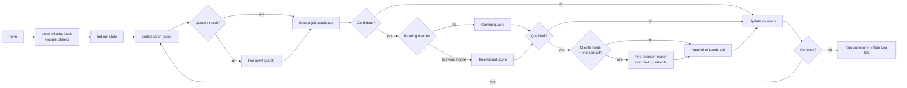

# Hiring Signal Lead Engine

An **n8n** workflow that finds job postings on public job boards and turns them into leads in Google Sheets. You choose how postings are ranked: **Gemini AI**, simple **keyword scoring** that needs no API key, or **no ranking**.

A job post means a company has a need right now. One engine, two modes:

| Mode | Who it's for | A job post means… | Extra step |
|---|---|---|---|
| **Find clients** | Dev agencies, freelancers, recruiters, outsourcing firms | "This company might buy my services" | Finds a decision-maker (CTO, founder, HR) on LinkedIn |
| **Find jobs for me** | Job seekers | "This job might fit me" | Scores the job against your CV and gives a tailoring tip |

## Just want to use it?

**You only need two things from this repo:**

1. [`workflow/hiring-signal-lead-engine.json`](workflow/hiring-signal-lead-engine.json): the workflow. Download it (open the file → **Download raw file**) and import it in n8n via **⋯ → Import from File**.
2. [`sheets/`](sheets): the header rows for your Google Sheet's `Leads` and `Run Log` tabs.

Then follow [Setup](#setup), a full beginner walkthrough, to connect your credentials. You can ignore everything else in the repo (`src/`, `scripts/`, `tests/`). It's only needed if you want to change the code; see [Development](#development).

| Path | What it is | Needed to run? |
|---|---|---|
| `workflow/*.json` | The n8n workflow | ✅ Yes |
| `sheets/*.csv` | Sheet header rows | ✅ Once, for setup |
| `src/nodes/*.js` | Readable source of each Code node (already inside the JSON) | ❌ Dev only |
| `scripts/build_workflow.py` | Rebuilds the JSON from `src/nodes/` | ❌ Dev only |
| `tests/simulate.js` | Offline test with mocked APIs | ❌ Dev only |

## Features

- **Searches several boards**: LinkedIn Jobs, Rozee.pk, Indeed, Bayt, Greenhouse, Lever, or any website. It does this through Firecrawl's search API. It doesn't log in anywhere or scrape LinkedIn itself.
- **Smart query rotation**: rotates boards and query patterns, broadens step by step when results dry up, and filters by date (past 24h, week or month).
- **One search feeds several leads**: extra results are queued, so a single paid search can produce several leads.
- **Choose the ranking method on the form**:
  - **AI ranking (Gemini)**: an LLM scores the fit and writes a reason plus a pitch angle or application tip.
  - **Keyword ranking (no AI)**: a free, instant score based on whether the role appears in the title, how many of your skills appear in the posting, and whether the location matches. No Gemini key needed.
  - **No ranking (save all)**: saves every valid, non-duplicate posting. This is the fastest and cheapest option.
- **AI qualification details**: Gemini returns structured JSON with a fit score (1–5), a reason, a pitch angle or application tip, and cleaned company, role and location fields. Leads below your minimum score are skipped.
- **Two layers of de-duplication**: by job URL (canonical LinkedIn/Indeed IDs) and by company + role, checked against the existing sheet and the current run.
- **Decision-maker lookup** (clients mode): a LinkedIn profile is only accepted if it actually mentions the company.
- **Fails safely**: stops after 3 Firecrawl errors in a row (bad key, out of credits). If Gemini is down, leads are still saved and marked "Not scored". Retries on Sheets writes.
- **Run log**: every run writes a summary row (saved, skipped, attempts, errors, status) to a `Run Log` tab.

## How it works



The loop stops when it saves the target number of leads, after too many failed attempts in a row, after repeated API errors, or when it reaches the overall attempt limit.

## Setup

This walkthrough assumes you've never used Google Cloud or n8n credentials before. Allow about 20–30 minutes the first time.

**What you'll set up:**

| # | Step | Needed? |
|---|---|---|
| 1 | [Google Sheet](#1-create-the-google-sheet) | ✅ Required |
| 2 | [Firecrawl API key](#2-get-a-firecrawl-api-key) | ✅ Required |
| 3 | [Gemini API key](#3-get-a-gemini-api-key-optional) | Optional (only for *AI ranking*) |
| 4 | [Google Sheets credential](#4-connect-google-sheets-to-n8n) | ✅ Required |
| 5 | [Create the API credentials in n8n](#5-create-the-firecrawl-and-gemini-credentials-in-n8n) | ✅ Required |
| 6 | [Import the workflow](#6-import-the-workflow) | ✅ Required |
| 7 | [Attach credentials and the sheet to each node](#7-attach-credentials-and-the-sheet-to-each-node) | ✅ Required |
| 8 | [Test and go live](#8-test-run-and-go-live) | ✅ Required |

---

### 1. Create the Google Sheet

1. Go to [sheets.new](https://sheets.new) to create a blank Google Sheet. Name it something like `Hiring Signal Leads`.
2. Rename the first tab (bottom-left) to exactly **`Leads`**: right-click the tab → **Rename**.
3. Click **+** (bottom-left) to add a second tab and rename it to exactly **`Run Log`**.
4. Open [`sheets/leads_headers.csv`](sheets/leads_headers.csv), copy the single line, click cell **A1** of the `Leads` tab, and paste.
   - If the whole line lands in cell A1, select A1 and go to **Data → Split text to columns**. Each header should end up in its own column (A, B, C, …).
5. Do the same in the **`Run Log`** tab with [`sheets/run_log_headers.csv`](sheets/run_log_headers.csv).
6. Copy the **Sheet ID** from the browser address bar and keep it somewhere handy:

   ```
   https://docs.google.com/spreadsheets/d/1AbCdEfGh-EXAMPLE-ID_1234567890/edit#gid=0
                                          └──────── this part is the Sheet ID ────┘
   ```

> ⚠️ The tab names and headers must match exactly, including capital letters and spaces. Don't add or rename columns.

---

### 2. Get a Firecrawl API key

1. Sign up at [firecrawl.dev](https://firecrawl.dev). The free plan includes some starter credits.
2. Open the **Dashboard** → **API Keys**.
3. Copy your key. It starts with `fc-`.

> Keep the key private. Don't paste it into the workflow JSON or commit it to GitHub; it goes into an n8n credential in step 5.

---

### 3. Get a Gemini API key *(optional)*

Skip this step if you'll only use *Keyword ranking* or *No ranking*.

1. Go to [Google AI Studio → API keys](https://aistudio.google.com/apikey) and sign in with your Google account.
2. Click **Create API key**. If it asks for a project, pick one or let it create one.
3. Copy the key. It usually starts with `AIza`.

---

### 4. Connect Google Sheets to n8n

How you do this depends on where n8n runs.

#### Option A: n8n Cloud (easy, about 1 minute)

1. In n8n, click **Overview** (left sidebar) → the arrow next to **Create Workflow** → **Create Credential**.
2. Search for **Google Sheets OAuth2 API** and select it.
3. Click **Sign in with Google**, choose your account, and click **Allow**.
4. You should see *"Account connected"*. Click **Save**. Then **skip to step 5**.

#### Option B: self-hosted n8n (localhost, VPS, Docker) — about 15 minutes

Google requires self-hosted apps to have their own "OAuth app". Follow these steps in order.

**4.1 — Copy the redirect URL from n8n first**

1. In n8n: **Overview** → arrow next to **Create Workflow** → **Create Credential** → search **Google Sheets OAuth2 API** → select it.
2. The form shows a field called **OAuth Redirect URL**. Copy it. It looks like this:
   - Local: `http://localhost:5678/rest/oauth2-credential/callback`
   - Server: `https://n8n.yourdomain.com/rest/oauth2-credential/callback`
3. Leave this browser tab open. You'll come back to paste the Client ID and Secret.

> If your server URL shows up as `localhost` but you open n8n through a domain, set the `WEBHOOK_URL` (or `N8N_EDITOR_BASE_URL`) environment variable to your real URL and restart n8n. The redirect URL must match the address you actually use.

**4.2 — Create a Google Cloud project**

1. Open [console.cloud.google.com](https://console.cloud.google.com) and sign in with the Google account that owns the sheet.
2. Accept the terms if this is your first visit. No billing or credit card is needed for this.
3. Click the **project picker** at the top (next to the Google Cloud logo) → **New Project**.
4. Name it `n8n-leadgen`, then click **Create**.
5. Wait about 10 seconds, then make sure the project picker shows **`n8n-leadgen`**. Every following step must happen inside this project.

**4.3 — Enable the two APIs**

1. Go to [APIs & Services → Library](https://console.cloud.google.com/apis/library).
2. Search for **Google Sheets API** → open it → click **Enable**.
3. Go back to the Library, search for **Google Drive API** → open it → click **Enable**.

> Both are needed. Sheets reads and writes the rows; Drive lets n8n find and list your spreadsheet. A missing API shows up later as a *"403 … API has not been used in project …"* error.

**4.4 — Set up the consent screen (Google Auth Platform)**

1. Go to [Google Auth Platform](https://console.cloud.google.com/auth/overview). It's also under ☰ menu → **APIs & Services → OAuth consent screen**.
2. If you see **Get started**, click it and fill in:
   - **App Information:** App name `n8n Lead Engine`; User support email = your Gmail → **Next**
   - **Audience:** choose **External** → **Next**
   - **Contact Information:** your Gmail → **Next**
   - **Finish:** tick *I agree…* → **Continue** → **Create**
3. Open **Audience** in the left menu. Under **Test users**, click **+ Add users**, enter **your own Gmail address**, and click **Save**.

> ⚠️ If you skip adding yourself as a test user, Google blocks sign-in with *"Error 403: access_denied"*.

**4.5 — Create the OAuth client (Client ID and Secret)**

1. Open **Clients** in the left menu → **+ Create client**.
2. **Application type:** **Web application**.
3. **Name:** `n8n`.
4. Under **Authorized redirect URIs**, click **+ Add URI** and paste the redirect URL you copied in 4.1.
   - Paste it exactly: `http` vs `https`, the port number, and no trailing slash all matter.
   - You don't need to fill in *Authorized JavaScript origins*.
5. Click **Create**.
6. A popup shows your **Client ID** and **Client secret**. Copy both now. Google only shows the full secret once (you can **Download JSON** as a backup).

**4.6 — Finish the credential in n8n**

1. Go back to the n8n credential tab from 4.1.
2. Paste the **Client ID** and **Client Secret**.
3. Click **Sign in with Google** and pick the Gmail you added as a test user.
4. Google will show **"Google hasn't verified this app"**. That's expected for your own private app. Click **Advanced** → **Go to n8n Lead Engine (unsafe)** → **Continue**, and tick all requested permissions.
5. n8n should show *"Account connected"*. Rename the credential to `Google Sheets account` (click the name at the top) and click **Save**.

**4.7 — Stop it from expiring every 7 days (recommended)**

While the app is in **Testing** mode, Google expires the login after 7 days and the workflow starts failing with `invalid_grant`. To avoid that:

1. Google Auth Platform → **Audience** → **Publish app** → **Confirm**.
2. In n8n, open the credential and click **Sign in with Google** once more.

Google doesn't need to review the app for your own personal use. You'll keep seeing the "unverified" warning, which is fine.

---

### 5. Create the Firecrawl and Gemini credentials in n8n

Both use the generic **Header Auth** type. To create each one: **Overview** → arrow next to **Create Workflow** → **Create Credential** → search **Header Auth** → select it.

**Firecrawl:**

| Field | Value |
|---|---|
| Credential name (top of the form) | `Firecrawl` |
| Name | `Authorization` |
| Value | `Bearer fc-YOUR_KEY` (the word **Bearer**, then **one space**, then your key) |

**Gemini** (only if you did step 3):

| Field | Value |
|---|---|
| Credential name | `Gemini` |
| Name | `x-goog-api-key` |
| Value | `AIza…YOUR_KEY` (just the key, no "Bearer") |

> **No Gemini key?** n8n won't let you activate a workflow while any node is missing a credential, even a node that never runs. Create a Header Auth credential named `Gemini (placeholder)` with Name `x-goog-api-key` and Value `none`. It's never used as long as you pick *Keyword ranking* or *No ranking* on the form.

Click **Save** on each. Under **Overview → Credentials** you should now see three (or four) credentials: `Google Sheets account`, `Firecrawl`, and `Gemini`.

---

### 6. Import the workflow

1. Download [`workflow/hiring-signal-lead-engine.json`](workflow/hiring-signal-lead-engine.json): open it on GitHub → click the **Download raw file** icon (top-right of the file view).
2. In n8n, click **Overview** → **Create Workflow**.
3. Click the **⋯** menu (top-right) → **Import from File…** → select the downloaded JSON.
4. The canvas fills with about 27 nodes. Some show a ⚠️ warning; the next step fixes those.
5. Press **Ctrl + S** (or click **Save**).

> Alternative: open the JSON file in a text editor, copy everything, click on the empty n8n canvas, and press **Ctrl + V**.

---

### 7. Attach credentials and the sheet to each node

Importing a workflow **never** brings credentials with it, so you have to connect them by hand. **Double-click** each node below to open it, make the changes, then close it with the **✕** or click back on the canvas.

#### 7.1 The three Google Sheets nodes

Nodes: **Load Existing Leads**, **Append Lead to Sheet**, **Append Run Log**

For each one:

1. **Credential to connect with** → choose `Google Sheets account`.
2. **Document**:
   - make sure the mode dropdown on the left says **By ID**;
   - replace `PASTE_YOUR_GOOGLE_SHEET_ID` with your Sheet ID from step 1.
   - *(Or switch the mode to **From list** and pick your spreadsheet by name.)*
3. **Sheet**:
   - **Load Existing Leads** and **Append Lead to Sheet** → `Leads`
   - **Append Run Log** → `Run Log`
   - If the field shows an error, switch its mode to **From list** and pick the tab from the dropdown.
4. For the two **Append** nodes, scroll to **Values to Send / Columns**. Each sheet column should map to an expression like `{{ $json['Company'] }}`. If n8n shows *"Column names were updated"*, click **Refresh columns** and make sure no column is marked *removed*.

#### 7.2 The two Firecrawl nodes

Nodes: **Firecrawl Search**, **Firecrawl Contact Search**

1. **Authentication** should already say *Generic Credential Type*, and **Generic Auth Type** should say *Header Auth*.
2. **Header Auth** → choose `Firecrawl`.

#### 7.3 The Gemini node

Node: **Gemini Qualify**

1. **Header Auth** → choose `Gemini`, or `Gemini (placeholder)` if you have no key.

#### 7.4 Optional: personalise the form

Node: **Lead Intake Form**. Here you can change the form title, description, or the default dropdown options.

#### 7.5 Final check

- No node on the canvas should show a ⚠️ or red triangle.
- Press **Ctrl + S** to save.

| Node | What to set |
|---|---|
| Load Existing Leads | Google credential · Sheet ID · `Leads` |
| Append Lead to Sheet | Google credential · Sheet ID · `Leads` |
| Append Run Log | Google credential · Sheet ID · `Run Log` |
| Firecrawl Search | `Firecrawl` |
| Firecrawl Contact Search | `Firecrawl` |
| Gemini Qualify | `Gemini` (or the placeholder) |

---

### 8. Test run and go live

1. Click **Execute workflow** (bottom-centre of the canvas; older n8n versions call it **Test workflow**). A test form opens in a new browser tab.
2. Fill it in, starting simple:
   - **Ranking method:** *Keyword ranking (no AI)*, so your first run doesn't depend on Gemini
   - **Maximum leads:** `10`
   - **Posted within:** *Past month*, which gives more results on a first test
3. Submit, then switch back to the n8n tab. Nodes light up green as they run, and the loop repeats until 10 leads are saved.
4. Check your Google Sheet: rows appear in **`Leads`**, and one summary row appears in **`Run Log`**.
5. Once that works, try again with **AI ranking (Gemini)**.
6. **Go live:** activate the workflow with the **Active** toggle (top-right), or the **Publish** button in n8n 2.x. Then open **Lead Intake Form** → **Production URL** and copy it. That's the link to share or bookmark. The *Test URL* only works while the editor is listening.

#### Troubleshooting

| Problem | Cause → fix |
|---|---|
| `Error 400: redirect_uri_mismatch` | The URI in Google **Clients** doesn't exactly match n8n's **OAuth Redirect URL** → copy and paste it again (check http/https, port, trailing slash). |
| `Error 403: access_denied` | Your Gmail isn't a test user → Google Auth Platform → **Audience** → add it. |
| "Google hasn't verified this app" | Normal for a private app → **Advanced → Go to … (unsafe)**. |
| `403 … Google Sheets API has not been used in project` | API not enabled → step 4.3 (enable **both** Sheets and Drive). |
| Workflow worked, then fails a week later with `invalid_grant` | App still in Testing mode → step 4.7 (publish, then sign in again). |
| `Sheet with name Leads not found` | The tab name doesn't match → rename it to exactly `Leads` / `Run Log`, or pick it **From list**. |
| Run Log status `api_error`, Last Error *Unauthorized* / *credits* | Firecrawl key wrong (check the `Bearer ` prefix) or out of credits. |
| Gemini error `model not found` | Change `aiModel` in the CONFIG block at the top of **Init Run State**. |
| Gemini error `API key not valid` | Check the Gemini credential: Name must be `x-goog-api-key`, Value must be only the key. |
| Run finishes with 0 or very few leads | Broaden the keywords or location, pick more job boards, or set *Posted within* to *Past month*. |
| Can't activate: "Node has issues" | A node still has no credential → step 7.5. |

## Form fields

| Field | Notes |
|---|---|
| Mode | Find clients, or Find jobs for me |
| Your name | Saved as *Run By* |
| Role or skill keywords | Comma-separated alternatives work, e.g. `Flutter developer, Mobile app developer` |
| Location | `/` or `,` separated, e.g. `Lahore / Karachi / Remote` |
| Job boards | Choose one or more; the workflow rotates between them |
| Posted within | Becomes the search date filter |
| What you offer / your CV summary | What Gemini scores against; more detail gives better scores |
| Ranking method | AI ranking (Gemini), Keyword ranking (no AI), or No ranking (save all) |
| Minimum fit score | Leads scoring below this are skipped (ignored with *No ranking*) |
| Find a decision-maker? | Clients mode only; uses one extra Firecrawl search per saved lead |
| Maximum leads | 10 / 25 / 50 |

## Configuration

All settings are in the `CONFIG` object at the top of the **Init Run State** node ([`src/nodes/init_run_state.js`](src/nodes/init_run_state.js)):

- `aiModel`: the Gemini model ID (default `gemini-3.7-flash`)
- `aiMinIntervalMs` and `firecrawlDelayMs`: pacing between API calls, to stay within rate limits
- `aiMinIntervalMs` only applies in AI ranking mode; keyword and no-ranking runs make no Gemini calls
- `contactRoles`: the job titles searched for in decision-maker lookup
- `boards`: add or edit job boards (a `site:` filter plus a regex that a single-posting URL must match)

## Costs and limits

- **Firecrawl:** each search uses credits. Thanks to the queue, one search can feed several candidates. Contact lookup costs one extra search per saved lead.
- **Gemini** (AI ranking only): one call per candidate, including candidates that get rejected. The free tier has per-minute and per-day limits, so for 50-lead runs you may want to raise `aiMinIntervalMs` or use a paid key.
- **Google Sheets:** existing leads are loaded **once** per run, not on every pass, which keeps you well under the read quota.
- Data comes from **search-engine results**: titles and snippets. They can be out of date or truncated, so always open the job URL before reaching out.

## Development

The Code-node sources live in [`src/nodes/`](src/nodes) so they're easy to read and test. The workflow JSON is generated from them:

```bash
python3 scripts/build_workflow.py   # rebuild workflow/hiring-signal-lead-engine.json
node tests/simulate.js              # offline end-to-end test with mocked APIs
```

The simulator runs the real node code through the workflow graph, with mocked Firecrawl, Gemini and Sheets. It checks seven scenarios: clients mode, jobs mode, Firecrawl out of credits, Gemini down, no results, keyword ranking, and no ranking.

If you edit a node directly in n8n, copy the code back into `src/nodes/` before rebuilding.

## Roadmap

- [ ] Scheduled daily re-runs from a `Saved Searches` tab
- [ ] Contact-page scrape to find public company emails
- [ ] Slack or email digest of new high-score leads
- [ ] Gemini Interactions API support

## Responsible use

The workflow only uses publicly indexed search results and never logs into or scrapes job boards or LinkedIn directly. Follow each site's terms, contact people respectfully, and comply with local data-protection laws (e.g. GDPR) when doing outreach.

## License

MIT. See [LICENSE](LICENSE).
